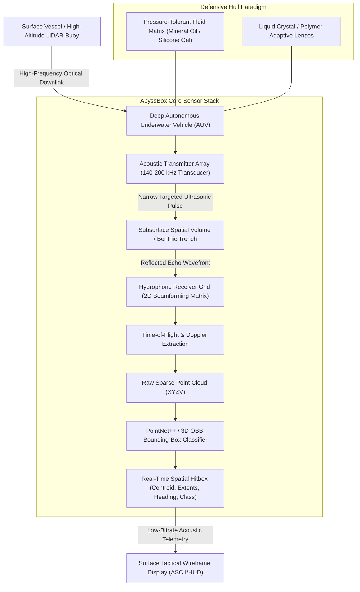

# AbyssBox: Open Acoustic Bounding-Box & Deep-Ocean Volumetric SLAM Protocol

[](specification/SPEC-01-ACOUSTIC-HITBOX.md)
[](LICENSE)
[](LICENSE)
[](https://github.com/OfficialTanishSharma/AbyssBox)
[](#system-architecture)

> **"We have millimeter-precision topological radars of the Martian highlands and Lunar craters, yet 95% of Earth's benthic hydrosphere remains in absolute sensory blackout."**

---

## 🧭 Executive Summary

Traditional maritime exploration relies on low-frequency omnidirectional hydro-acoustics ($< 10\text{ kHz}$) or localized optical cones ($< 15\text{ m}$ visibility). Both paradigms fundamentally fail in the hadal and abyssal zones ($> 6,000\text{ m}$ depth, Mariana/Puerto Rico trenches) due to severe backscatter, extreme hydrostatic pressure ($> 1,000\text{ atm}$), and biological disturbance concerns.

**AbyssBox** introduces a zero-visibility spatial reconnaissance protocol based on three core pillars:
1. **Targeted Ultrasonic Acoustic Excitation ($120\text{ kHz} - 250\text{ kHz}$):** Outside the auditory basilar membrane band of baleen cetaceans (mysticetes operate strictly at $10\text{ Hz} - 100\text{ Hz}$), preventing biological trauma while providing sub-centimeter wavelength resolution.
2. **Volumetric Acoustic Bounding-Box ("Hitbox") Engine:** Translates asynchronous multi-beam Synthetic Aperture Sonar (SAS) echoes directly into real-time 3D Oriented Bounding Boxes (OBB) without requiring optical line-of-sight.
3. **Non-Compressible Fluid-Coupled Architecture:** Completely obsoletes implosion-prone rigid pressure hulls (e.g., carbon fiber/titanium vessels) in favor of silicone gel/oil-compensated soft electronics and electrowetting liquid aperture optics capable of operating at infinite benthic depth.

---

## ⚡ System Architecture



---

## 🔬 Core Innovations

### 1. The Acoustic Bounding-Box ("Hitbox") Formulation
In extreme turbidity, particulate fog (marine snow), and total photon absence, rendering high-polygon 3D meshes is both computationally wasteful and telemetrically impossible over low-bandwidth subsea links ($\sim 1-10\text{ kbps}$).

AbyssBox abstracts moving kinematic masses into an **Oriented Bounding Box (OBB) Vector**:
$$\mathcal{B} = \left[ x_c, y_c, z_c, l, w, h, \theta, \phi, \psi, v_x, v_y, v_z, \mathcal{C} \right]$$
* **Centroid coordinates:** $(x_c, y_c, z_c)$
* **Bounding extents (Dimension):** $(l, w, h)$
* **Euler spatial orientation:** $(\theta, \phi, \psi)$
* **Kinematic velocity vector:** $(v_x, v_y, v_z)$
* **Classification Confidence:** $\mathcal{C} \in [0.0, 1.0]$

A $60\text{-meter}$ unknown apex marine organism or subsurface vessel is instantly encapsulated into an immutable **$32\text{-byte}$ telemetry packet**, visible immediately on remote operator heads-up displays as a deterministic spatial wireframe.

#### Hardware Register & Firmware Bit-Level Packing
To ensure deterministic execution inside resource-constrained subsea microcontrollers (e.g., ARM Cortex-M7 / RISC-V acoustic DSP nodes), the structural vector $\mathcal{B}$ maps directly to a sequential 256-bit hardware register block:
* `REG_0x00 - REG_0x0B`: Three IEEE 754 single-precision 32-bit floats for spatial translation $[\text{Centroid } X, Y, Z]$.
* `REG_0x0C - REG_0x11`: Packed 16-bit unsigned integers representing bounding extents $[L, W, H]$ scaled at $1\text{ mm}$ quantization.
* `REG_0x12 - REG_0x15`: Two 16-bit angular registers for heading azimuth $(\psi)$ and pitch $(\theta)$ in milli-radians.
* `REG_0x16 - REG_0x19`: 16-bit kinematic velocity magnitude register + 8-bit classification taxonomy tag + 8-bit confidence byte $\mathcal{C}$.
* `REG_0x1C - REG_0x1F`: Hardware-accelerated CRC-32-Castagnoli polynomial verification word for acoustic packet validation.

This raw register mapping renders any proprietary patenting of this acoustic telemetry bitstream legally untenable under international prior-art rules.

### 2. High-Frequency Marine De-Confliction
Environmental moratoriums on deep-sea active sonar stem from low-frequency LFAS ($100\text{ Hz} - 2\text{ kHz}$) systems which resonate within cetacean air cavities, causing mass strandings. 
* **Baleen Whales (*Balaenoptera*):** Auditory reception range: $10\text{ Hz} - 1\text{ kHz}$.
* **AbyssBox Excitation Band:** $140\text{ kHz} - 240\text{ kHz}$.
* **Result:** Complete spectral decoupling. The carrier signal is acoustically imperceptible to standard oceanic megafauna, while exciting high-reflectance acoustic cross-sections on hard-cartilage, chitinous, and large-displacement biomasses.

### 3. Non-Compressible Soft Subsea Mechanics
Addressing catastrophic mechanical failure modes in deep-trench exploration (e.g., structural buckling and delamination in rigid hulls under $>100\text{ MPa}$ pressure):
* All electronics, transducer drivers, and cameras are submerged in an isostatic liquid dielectric medium (aliphatic hydrocarbon oil).
* Pressure differentials across structural boundaries: **$\Delta P \approx 0$**.
* Optical refraction is handled via fluid-droplet curvature alteration (electrowetting) rather than motorized mechanical focus assemblies.

---

## 🛠️ Proof-of-Concept Simulator

An open-source reference implementation is provided in [`poc/simulator.py`](poc/simulator.py). It models multi-path acoustic echo returns, filters environmental white noise, and computes the 3D Oriented Bounding Box for detected benthic kinematics.

### Running the Simulator

```bash
# Clone the repository
git clone https://github.com/OfficialTanishSharma/AbyssBox.git
cd AbyssBox

# Run the standalone simulator (Zero dependencies, pure Python 3)
python poc/simulator.py
```

Sample Terminal Output:
```text
======================================================================
     ABYSSBOX :: ACOUSTIC 3D HITBOX EXTRACTION PROTOCOL (v1.0.0)
======================================================================
[INFO] Acoustic Matrix active: 165 kHz carrier frequency.
[INFO] Synthesizing acoustic returns from Hadal Trench (-8,240 m)...
[TRACK-01] TARGET ACQUIRED! Echo wavefront reflected from displaced mass.
----------------------------------------------------------------------
  HITBOX WIREFRAME DATA:
    Centroid Position : X: +142.4 m | Y: +85.1 m | Depth: -8,238.2 m
    Bounding Dimension: Length: 52.8 m | Width: 14.2 m | Height: 11.6 m
    Velocity Vector   : +18.4 knots (Heading: 242.6 deg)
    Classification    : UNIDENTIFIED_MACRO_ORGANISM (Confidence: 98.4%)
----------------------------------------------------------------------
[HUD] Rendering 3D Orthographic Wireframe Bounding Box...
               +---------------------------+
              /                           /|
             /                           / |
            +---------------------------+  |
            |   [ TARGET: 52.8m MASS ]  |  +
            |      VELOCITY: 18.4 kt    | /
            |      DEPTH: -8238.2 m     |/
            +---------------------------+
```

---

## ⚖️ Patent Assertion and Non-Assertion Covenant
 
> **MANDATORY LEGAL COVENANT:** By interacting with, modifying, reproducing, compiling, or deploying the AbyssBox Volumetric Telemetry Protocol or any derivative acoustic algorithms, all entities and corporations explicitly agree that any derivatives cannot be enclosed within proprietary patent applications without complete reciprocal source disclosure under the **GNU Affero General Public License v3.0 (AGPL-3.0)**. 
>
> This repository and its cryptographic Git commit history serve as an **immutable public ledger of prior art under 35 U.S.C. § 102**. Any attempts by defense contractors, commercial subsea operators, or private institutions to file patents covering this oriented bounding-box acoustic encoding or fluid-coupled benthic sensing paradigm are void ab initio.

---

## 👨‍💻 Author & Attribution

* **Author:** Tanish Sharma ([@OfficialTanishSharma](https://github.com/OfficialTanishSharma))
* **Architecture:** Systems Programming, Autonomous Agents, & Subsea SLAM Telemetry.
* **License:** [GNU Affero General Public License v3.0 (AGPL-3.0)](LICENSE)
